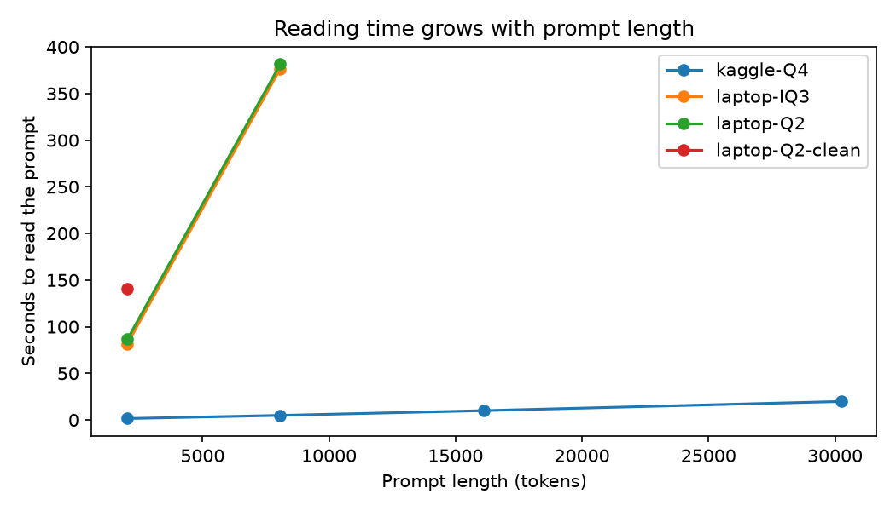
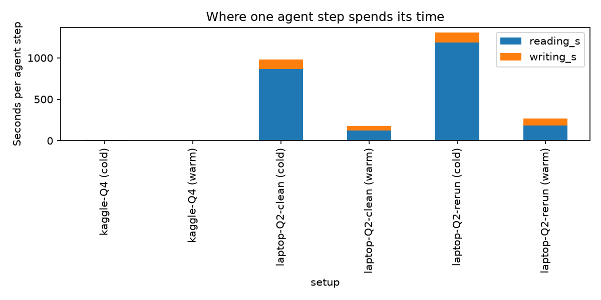

# flint-edge-bench

How long does an AI coding agent spend reading versus writing when it runs on ordinary hardware? This repo measures that for Flint-40B-A2B, the open-weight coding model from Recursive Superintelligence. It is an independent project and is not affiliated with Recursive.

## Why I did this

Coding agents work in a loop. Each step, the agent sends the whole conversation so far to the model, the model reads it, and then writes a short reply such as a command or an edit. The conversation only grows, so the reading part gets bigger every step.

Speed numbers published for models like Flint mostly describe how fast they write, at short context. They leave out the reading part. For someone running the model on a laptop, the reading part can be the larger cost. I wanted to measure it directly instead of guessing.

The questions were:
1. How much of an agent step is reading and how much is writing?
2. How much does the prompt cache help?
3. What does this look like on hardware that a student or hobbyist can actually own or borrow for free?

## What I tested on

| | Laptop | Kaggle |
|---|---|---|
| Machine | Acer Aspire A715-79G, Intel Core i5-13420H (8 cores, 12 threads), 16 GB RAM (15.7 GB usable, one module at 3200 MT/s), NVIDIA GeForce RTX 3050 6GB Laptop GPU (6,144 MiB, driver 576.93) | Free Kaggle notebook with 2x NVIDIA T4 (32 GB VRAM in total) |
| Model files | Unsloth GGUF builds: UD-Q2_K_XL (13.6 GB) and UD-IQ3_XXS (14.5 GB) | A Q4 build of the same model |
| Runtime | WSL2 on Windows, llama.cpp build 11838 (commit 4231b23dc) | llama.cpp |
| Main server flags | `-c 32768 -ngl 99 --n-cpu-moe 99` plus the sampling settings below | Fill in before publishing |

Sampling for all runs: temperature 1.0, top-p 0.95, top-k 20, which are the settings the model authors recommend. The agent was mini-swe-agent 2.4.6.

Flint is a mixture-of-experts model with about 40 billion parameters in total and about 2.5 billion active per token. The `--n-cpu-moe 99` flag keeps all the expert weights in system RAM and leaves the rest on the GPU. That is what lets a 13.6 GB model run on a 6 GB card.

## What I did, step by step

1. **Speed sweep.** `src/speed_sweep.py` sends prompts of fixed lengths (2,000 to 30,000 tokens) and reads back the timings that llama-server reports. This gives reading speed and writing speed by prompt length.
2. **Live agent runs.** I ran mini-swe-agent on 3 SWE-bench Verified tasks on the laptop with a 30-step limit. A small proxy (`src/proxy.py`) sat between the agent and the model server and saved every request and its timings to a trace file.
3. **Trace cleaning.** Some raw trace files contained several runs of the same task, including runs I stopped early. `src/clean_traces.py` split them apart and kept the longest run per task. It dropped 3 shorter runs (14, 4 and 4 steps). No duplicate requests and no rows without timings were found. The cleaned traces are in `traces_clean/laptop-Q2/`.
4. **Replay.** `src/replay.py` takes real prompts from the cleaned traces and sends them to a model server again, so the same prompts can be timed on different machines.
   - **Cold mode:** the cache is cleared for each prompt, so the model reads the full prompt.
   - **Warm mode:** consecutive steps of one task are sent in order and the cache is kept, so the model reads only the new part.
   - Each replay generates a short 64-token answer to measure writing speed. The step time is then estimated as reading time plus the original run's recorded answer length divided by that measured writing speed.
5. **Hack checks.** `src/hack_checks.py` scans each run for signs of cheating: edits to test files, network use, and peeking at git history. A flag is only a hint for a person to check.
6. **Summary.** `src/summarize.py` builds `results/summary.md` and two charts from all the result files.

The Kaggle notebook had no Docker, so agent runs happened only on the laptop. Kaggle was used only for replays and the speed sweep.

## Results

### 1. Reading speed and writing speed by prompt length

Reading and writing speed, from `results/speed/`:

| Setup | Prompt length | Reading speed | Writing speed |
|---|---|---|---|
| Kaggle 2x T4, Q4 | 2,000 to 30,000 tokens | 1,366 to 1,651 tok/s | 49.7 to 57.4 tok/s |
| Laptop, Q2 | 2,000 and 8,000 tokens | 21.2 to 23.5 tok/s | 1.8 to 2.5 tok/s |
| Laptop, IQ3 | 2,000 and 8,000 tokens | 21.4 to 24.9 tok/s | 1.9 to 2.6 tok/s |

A 30,000-token prompt took 19.8 seconds to read on Kaggle. An 8,000-token prompt took about 6.4 minutes on the laptop in the best session.



### 2. Where one agent step spends its time

Average per step, from `results/replay/`. The laptop was tested in two separate sessions with the Q2 build.

| Setup | Steps | New tokens read | Reading | Writing | Step total | Reading share |
|---|---|---|---|---|---|---|
| Kaggle, cold cache | 12 | 12,538 | 9.0 s | 1.6 s | 10.6 s | 85% |
| Kaggle, warm cache | 12 | 1,463 | 1.6 s | 3.0 s | 4.6 s | 35% |
| Laptop session 1, cold | 4 | 11,885 | 865 s | 113 s | 978 s | 88% |
| Laptop session 1, warm | 4 | 1,429 | 121 s | 56 s | 177 s | 68% |
| Laptop session 2, cold | 4 | 11,885 | 1,183 s | 122 s | 1,304 s | 91% |
| Laptop session 2, warm | 4 | 1,423 | 182 s | 88 s | 270 s | 67% |



The cold and warm rows use different steps, so read the gap between them as a range and not as an exact saving. Reading is the biggest share of a step in every setup except Kaggle with a warm cache.

### 3. Same prompts on both machines

Four cold-cache prompts were replayed on both setups. These are the same prompts, so the comparison is fair on input. It is not fair on hardware alone, because Kaggle ran Q4 and the laptop ran Q2.

| Prompt tokens | 2x T4, Q4 | Laptop session 1 | Laptop session 2 |
|---|---|---|---|
| 2,835 | 3.7 s | 290 s | 440 s |
| 10,529 | 7.9 s | 590 s | 791 s |
| 10,541 | 10.7 s | 1,090 s | 1,503 s |
| 23,636 | 17.4 s | 1,943 s | 2,483 s |

The laptop was 75 to 142 times slower on these steps. The longest prompt took about 32 minutes in session 1 and about 41 minutes in session 2.

### 4. Laptop speed changed between sessions

Reading speed on a 2,000-token prompt with the Q2 build:

| Date | Reading speed | Notes |
|---|---|---|
| Oct 24 | 23.5 tok/s | `--n-cpu-moe 99` |
| Nov 6 | 14.4 tok/s | `--n-cpu-moe 30`, batch size 2048, WSL limited to 11 GB |
| Nov 9 | 9.4 and 10.0 tok/s | `--n-cpu-moe 99`, without and with batch size 2048 (files in `results/archive/`) |

Using the October flags again on Nov 9 did not bring back the October speed, so the flags were not the cause. I did not find the cause. Possible causes are memory pressure in WSL, power settings and heat, but I did not test them. If you run on a laptop, expect numbers to move by a factor of two or more between sessions.

### 5. Writing slows down as the prompt grows

On the laptop, measured writing speed fell from 0.91 tok/s at a 2,835-token prompt to 0.63 tok/s at 10,541 and 0.44 tok/s at 23,636 (session 1). On Kaggle it fell more gently, from 58.2 to 51.5 tok/s over the same prompts.

### 6. Live agent pilot (3 SWE-bench Verified tasks)

| Task | Steps | Result | Time reading | Time writing |
|---|---|---|---|---|
| django__django-14672 | 21 | Submitted | 18.5 min | 39.9 min |
| sphinx-doc__sphinx-10449 | 30 | Hit the step limit, no patch | 75.1 min | 144.4 min |
| django__django-11299 | 30 | Hit the step limit, no patch | 33.5 min | 162.2 min |

A task took 157.8 minutes on average and reading was 27.7% of that on average. This is lower than the replay figures because these live runs were memory-starved: WSL was capped at 5 GB, Docker was running at the same time and the model was writing at only 0.3 to 0.9 tok/s. Treat the live timings as a worst case and not as Flint's real speed.

The one submitted patch (for django-14672) wraps two values in `make_hashable`. It was not scored, so I make no claim about whether it is correct. See "What this does not show".

### 7. Hack checks

The script flagged all 3 runs. After reading the traces, none showed cheating:
- 2 runs were flagged `empty_patch` because they hit the step limit without a patch.
- 1 run was flagged `git_history_peek`. The matched command was `git stash`, which the model used to confirm that the bug existed before its change and then restored with `git stash pop`. That is normal debugging.

See `results/hacks/`.

## What this does not show

- **No accuracy result.** The 3 tasks are far too few to say anything about how well Flint solves SWE-bench problems, and the one patch was not scored.
- **Small samples.** The laptop replays use 4 steps per mode. The Kaggle replays use 12. Most speed numbers come from one or two runs.
- **Quantization and hardware are mixed.** Laptop results are for Q2 and IQ3. Kaggle results are for Q4. I could not run Q4 on the laptop because the file does not fit.
- **Exact server settings were not always saved.** The flags for the second laptop replay session were not recorded, and the Kaggle flags are not in this repo yet.
- **The writing speed is measured, not replayed in full.** Writing time is estimated from a 64-token test and the answer lengths of the original runs. Long answers may be slower than the estimate.
- **One agent and one benchmark.** Other agents and tasks may behave differently.
- I did not test NVFP4, Apple Silicon or Recursive's own `rec` engine.

## What I would try next

- Record the full server settings and room conditions (power, temperature, free memory) for every run.
- Repeat the laptop replays several times on a quiet machine to measure how much the speed varies.
- Score the patches with the SWE-bench cloud tool (`sb-cli`) over more tasks.
- Test whether agent settings that keep the start of the prompt identical between steps help the cache more.

## Repo layout

```
src/
  speed_sweep.py     reading and writing speed by prompt length
  proxy.py           saves every agent request and its timings
  clean_traces.py    splits and cleans raw traces
  replay.py          replays recorded prompts, cold or warm
  hack_checks.py     flags runs that may have cheated
  summarize.py       builds the tables and charts
scripts/smoke_test.py   checks that the model server answers
traces_clean/           cleaned traces (3 tasks, 81 steps)
results/
  speed/  replay/  hacks/  accuracy/  archive/
  summary.md  reading_time.png  step_time.png
```

`results/accuracy/` holds the predictions file from the pilot. `results/archive/` holds early test runs that I kept out of the main tables.

## How to reproduce

```
pip install -r requirements.txt
```

1. Start llama-server with the model and the flags above, on port 8080.
2. Speed sweep: `python src/speed_sweep.py --tag my-run --sizes 2000,8000 --runs 2`
3. Replays on the included traces:
   ```
   python src/replay.py --traces traces_clean/laptop-Q2 --tag my-run --samples 4 --warm
   python src/replay.py --traces traces_clean/laptop-Q2 --tag my-run --samples 4
   ```
4. Hack checks: `python src/hack_checks.py runs/laptop-Q2`
5. Tables and charts: `python src/summarize.py`

To collect new live traces, run mini-swe-agent with its API base pointed at `src/proxy.py`, a step limit of 30 and a long request timeout.

## Credits

Flint-40B-A2B is by Recursive Superintelligence. GGUF builds are by Unsloth. The agent is mini-swe-agent. Inference is llama.cpp. Tasks come from SWE-bench Verified.